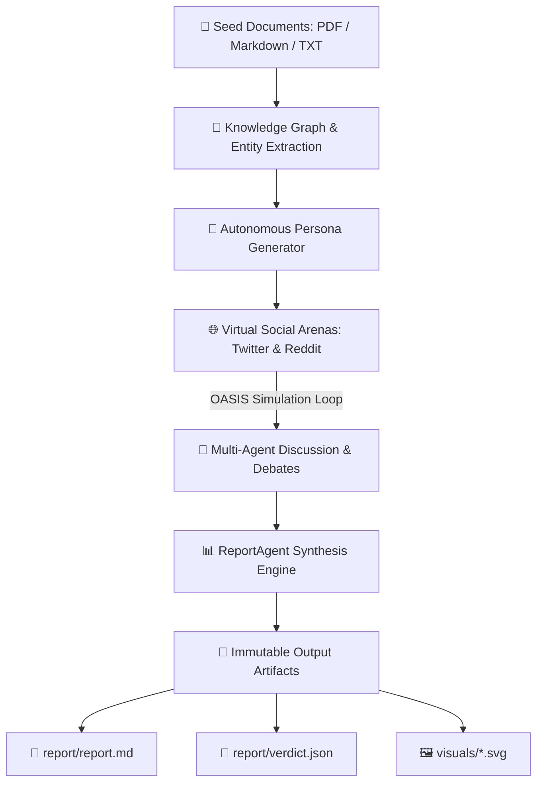

# MiroFish CLI AGY (mirofish-cli-agy)

<div align="center">

[](https://www.gnu.org/licenses/agpl-3.0)
[](https://www.python.org/)
[-4285F4.svg?logo=google&logoColor=white)](https://github.com/almazid-shisir/mirofish-cli-agy)
[](https://github.com/camel-ai/oasis)
[](https://github.com/almazid-shisir/mirofish-cli-agy)

**Universal Swarm Intelligence & Social Media Prediction Engine**  
*Powered by Google Antigravity CLI (`agy`), Anthropic Claude Code CLI (`claude`), and CAMEL-AI OASIS*

[Features](#-key-features) • [Architecture](#-architecture) • [Quick Start](#-quick-start) • [Usage](#-usage-guide) • [Configuration](#-configuration) • [Output Format](#-output-artifacts) • [License](#-license)

</div>

---

## ⚡ Overview

**MiroFish CLI AGY** (`mirofish-cli-agy`) is an advanced multi-agent prediction sandbox and social simulation engine. Feed it raw seed documents (such as breaking policies, financial reports, or news articles) along with a predictive question, and it automatically:

1. **Constructs a Knowledge Graph (GraphRAG)** from your text.
2. **Generates autonomous persona agents** with distinct cognitive profiles, stances, and memory.
3. **Simulates social interactions** on virtual Twitter and Reddit environments.
4. **Synthesizes predictive reports** with quantitative confidence scores, scenario trajectories, and machine-readable `verdict.json` outputs.

Best of all: **No costly third-party API keys required.** It leverages your existing **Google Antigravity CLI (`agy`)** or **Claude Code CLI** sessions directly!

---

## 🚀 Key Features

- **💸 Zero Extra API Token Costs:** Directly bridges to your locally authenticated Antigravity CLI (`agy -p`) or Claude Code CLI (`claude -p`).
- **🕸️ GraphRAG Knowledge Graph:** Parses PDF, Markdown, and TXT documents into strongly typed ontology graphs and entity relationships.
- **🤖 Autonomous Multi-Agent Personas:** Dynamically synthesizes diverse social actors (e.g. skeptical commuters, government analysts, industry representatives).
- **📱 Dual-Platform Social Simulation:** Runs parallel Twitter (posts, reposts, likes) and Reddit (threads, comments, upvotes) simulation waves using CAMEL-AI OASIS.
- **📈 Quantitative Prediction & Analysis:** Outputs probability confidence scores, pivotal dynamics, trend trajectories, and risk indicators.
- **🎨 Visual Snapshots:** Generates lightweight SVG network interaction graphs without needing a headless browser.

---

## 🏗️ Architecture



---

## 📦 Quick Start

### Prerequisites
- **Python**: 3.11 or 3.12
- **[uv](https://docs.astral.sh/uv/)**: Recommended package manager
- **CLI Engine**: Google Antigravity CLI (`agy`) or Claude Code CLI (`claude`)

### 1. Installation

```bash
# Clone the repository
git clone https://github.com/almazid-shisir/mirofish-cli-agy.git
cd mirofish-cli-agy

# Install dependencies using uv
uv sync

# Or install globally as a tool
uv tool install --editable .
```

### 2. Verify Diagnostics

Run `mirofish doctor` to verify that your environment and provider CLI are linked:

```bash
mirofish doctor
```

Output:
```text
  [PASS] LLM_PROVIDER set  
  [PASS] LLM_PROVIDER valid
  [PASS] agy binary on PATH

doctor: all checks passed
```

---

## 🎮 Usage Guide

### Run a Predictive Simulation

Feed a document and ask a predictive requirement in plain English:

```bash
mirofish run \
  --files examples/test_scenario.md \
  --requirement "Predict public sentiment and commuter reaction over the next 30 days" \
  --max-rounds 3
```

#### CLI Options:
| Flag | Description | Default |
| :--- | :--- | :--- |
| `--files` | List of input documents (`.pdf`, `.md`, `.txt`) | *Required* |
| `--requirement` | Natural language prediction query | *Required* |
| `--platform` | Social media platform: `parallel`, `twitter`, `reddit` | `parallel` |
| `--max-rounds` | Maximum debate/simulation rounds | `10` |
| `--output-dir` | Directory to store run outputs | `uploads/runs` |
| `--json` | Output structured JSON to `stdout` | `False` |

### Manage Past Runs

```bash
# List all simulation runs
mirofish runs list --json

# View full manifest and status of a run
mirofish runs status <run_id> --json

# Export simulation artifacts
mirofish runs export <run_id> --json
```

---

## ⚙️ Configuration

Configure your environment in `.env` (copied from `.env.example`):

```bash
cp .env.example .env
```

```env
# LLM Provider Configuration
# agy-cli: Uses Google Antigravity CLI (agy -p) [Default]
# claude-cli: Uses Anthropic Claude Code CLI (claude -p)
# codex-cli: Uses OpenAI Codex CLI (codex exec)
LLM_PROVIDER=agy-cli
```

---

## 📊 Output Artifacts

Every simulation creates an immutable run record under `uploads/runs/<run_id>/`:

```text
uploads/runs/<run_id>/
├── manifest.json         # Complete execution metadata & inputs
├── report/
│   ├── verdict.json      # Structured prediction scores & signals
│   ├── summary.json      # Executive summary
│   └── report.md         # Comprehensive markdown analysis report
├── visuals/
│   └── network.svg       # Social network interaction graph
└── simulations/          # Raw OASIS social media logs & posts
```

### Example `verdict.json`:

```json
{
  "prediction": "Widespread initial commuter backlash followed by selective adaptation among EV drivers.",
  "confidence": 0.84,
  "key_dynamics": [
    "Peak toll dissatisfaction driving early protest hashtags",
    "Transit advocacy mobilization defending environmental gains",
    "Commercial delivery freight passing cost surcharges to consumers"
  ],
  "signals": [
    { "indicator": "Public Backlash", "risk_level": "HIGH", "trend": "Peaking Day 3-7" },
    { "indicator": "Traffic Congestion Reduction", "expected_change": "-18%", "confidence": 0.79 }
  ]
}
```

---

## 🏷️ Topics & Search Keywords

`swarm-intelligence` • `multi-agent-systems` • `antigravity-cli` • `gemini` • `oasis-simulation` • `social-simulation` • `graphrag` • `future-prediction` • `claude-code-cli` • `camel-ai`

---

## 📄 License & Acknowledgments

- **License:** [AGPL-3.0 License](LICENSE)
- **Upstream Engine:** [666ghj/MiroFish](https://github.com/666ghj/MiroFish)
- **Simulation Layer:** [CAMEL-AI OASIS](https://github.com/camel-ai/oasis)
- **CLI & Antigravity Port:** Developed and maintained by [almazid-shisir](https://github.com/almazid-shisir).
