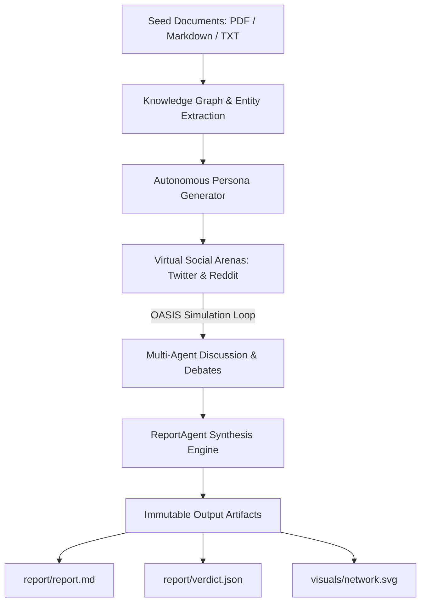

# MiroFish CLI AGY (mirofish-cli-agy)

Universal Swarm Intelligence and Social Prediction Engine powered by Google Antigravity CLI (`agy`), Anthropic Claude Code (`claude`), OpenAI Codex (`codex`), and CAMEL-AI OASIS.

MiroFish CLI AGY is a multi-agent prediction sandbox and social simulation engine. It ingests seed documents (policies, market reports, breaking news), constructs a GraphRAG knowledge graph, generates autonomous persona agents with diverse viewpoints, simulates discussions across virtual Twitter and Reddit environments, and synthesizes quantitative predictive verdicts and comprehensive markdown reports.

Zero external API token costs are required when using your locally authenticated Antigravity CLI (`agy`) or Claude Code CLI (`claude`).

---

## Table of Contents

- [Features](#features)
- [Architecture](#architecture)
- [Prerequisites](#prerequisites)
- [Installation and Setup](#installation-and-setup)
- [Configuration](#configuration)
- [Model Context Protocol (MCP) Server](#model-context-protocol-mcp-server)
- [CLI Usage](#cli-usage)
- [Ready-Made Prompts](#ready-made-prompts)
  - [Google Antigravity CLI](#1-google-antigravity-cli-agy)
  - [Anthropic Claude Code CLI](#2-anthropic-claude-code-cli-claude)
  - [OpenAI Codex CLI](#3-openai-codex-cli-codex)
  - [Autonomous and Agentic Orchestrators](#4-autonomous-and-agentic-orchestrators)
- [MCP Tool Reference](#mcp-tool-reference)
- [Output Artifacts](#output-artifacts)
- [License and Credits](#license-and-credits)

---

## Features

- Zero Extra API Token Costs: Bridges directly to your local Antigravity CLI (`agy -p`) or Claude Code CLI (`claude -p`).
- GraphRAG Knowledge Graph: Parses PDF, Markdown, and TXT files into structured entity and relationship graphs using Kuzu graph database.
- Autonomous Persona Synthesis: Generates distinct cognitive profiles, stances, and memory for simulated participants.
- Dual-Platform Social Simulation: Runs parallel Twitter (posts, reposts, likes) and Reddit (threads, comments, upvotes) simulation waves using CAMEL-AI OASIS.
- Quantitative Prediction: Synthesizes probability confidence scores, pivotal dynamics, trend trajectories, and machine-readable `verdict.json`.
- Visual Interaction Graphs: Generates lightweight SVG network interaction graphs without requiring a browser or rendering engine.
- FastMCP Server: Exposes 8 tools for native integration into Antigravity CLI, Claude Code, Cursor, Codex, and agentic workflows.
- Asynchronous Execution: Background worker thread support for long-running multi-agent simulations.

---

## Architecture



---

## Prerequisites

- Operating System: Linux or macOS
- Python: 3.11 or 3.12
- Package Manager: [uv](https://docs.astral.sh/uv/) (recommended) or pip
- CLI Provider: Google Antigravity CLI (`agy`) or Anthropic Claude Code CLI (`claude`)

---

## Installation and Setup

### 1. Clone the Repository

```bash
git clone https://github.com/almazid-shisir/mirofish-cli-agy.git
cd mirofish-cli-agy
```

### 2. Install Dependencies

Using `uv` (recommended):

```bash
# Sync environment dependencies
uv sync

# Install the CLI and MCP binary locally
uv tool install --editable .
```

Alternatively, using standard `pip`:

```bash
pip install -e .
```

### 3. Verify Installation

Run the built-in diagnostic tool to confirm all dependencies, binaries, and providers are properly linked:

```bash
mirofish doctor
```

Expected diagnostic output:

```text
[PASS] LLM_PROVIDER set
[PASS] LLM_PROVIDER valid
[PASS] agy binary on PATH

doctor: all checks passed
```

---

## Configuration

Copy `.env.example` to `.env` and set your desired provider:

```bash
cp .env.example .env
```

Configuration variables in `.env`:

```env
# LLM Provider: agy-cli (default), claude-cli, or codex-cli
LLM_PROVIDER=agy-cli

# Optional: Path overrides
# RUNS_DIR=uploads/runs
# GRAPH_STORAGE_PATH=uploads/graphs
```

Supported LLM Providers:
- `agy-cli`: Uses Google Antigravity CLI (`agy -p`) with JSON output parsing. No API key required.
- `claude-cli`: Uses Anthropic Claude Code CLI (`claude -p`).
- `codex-cli`: Uses OpenAI Codex CLI (`codex exec`).

---

## Model Context Protocol (MCP) Server

MiroFish includes a built-in FastMCP server (`mirofish-mcp`), allowing AI coding assistants and autonomous agents to run simulations, monitor progress, and retrieve reports via standardized tool calls.

### Register with Antigravity CLI

```bash
# Add mirofish to Antigravity CLI MCP registry
agy mcp add mirofish /root/.local/bin/mirofish-mcp

# Verify registration
agy mcp list
```

### Register with Claude Desktop / Claude Code

Add the following configuration to your `claude_desktop_config.json`:

```json
{
  "mcpServers": {
    "mirofish": {
      "command": "/root/.local/bin/mirofish-mcp",
      "args": []
    }
  }
}
```

---

## CLI Usage

### Run a Prediction Simulation

Pass source documents and a predictive requirement:

```bash
mirofish run \
  --files examples/test_scenario.md \
  --requirement "Predict public sentiment and commuter reaction over the next 30 days" \
  --max-rounds 3
```

CLI Options:

| Option | Type | Default | Description |
| :--- | :--- | :--- | :--- |
| `--files` | Path(s) | Required | Input documents (`.pdf`, `.md`, `.txt`) |
| `--requirement` | String | Required | Natural language prediction objective |
| `--platform` | String | `parallel` | Simulation arena: `parallel`, `twitter`, `reddit` |
| `--max-rounds` | Integer | `10` | Maximum debate and simulation rounds |
| `--output-dir` | Path | `uploads/runs`| Output artifact directory |
| `--json` | Flag | `False` | Output structured JSON to stdout |

### Manage Past Runs

```bash
# List all simulation runs
mirofish runs list --json

# View run status and manifest
mirofish runs status <run_id> --json

# Export run artifacts
mirofish runs export <run_id> --json
```

---

## Ready-Made Prompts

Copy and paste these prompts directly into your AI assistant or agent terminal.

### 1. Google Antigravity CLI (`agy`)

#### Interactive MCP Simulation Prompt
Copy and paste into your Antigravity chat:

```text
Run a predictive simulation using the MiroFish MCP server:
1. Start simulation with `mirofish_start_simulation`:
   - files: ["examples/test_scenario.md"]
   - requirement: "Predict public adoption, backlash risk, and 30-day sentiment trajectory"
   - max_rounds: 3
   - run_in_background: true
2. Check execution progress using `mirofish_get_status` until phase is 'completed'.
3. Fetch `mirofish_get_verdict` and `mirofish_get_report`.
4. Provide a structured summary containing:
   - Prediction headline and confidence score
   - Key social and market dynamics
   - High-risk indicators
   - Recommended interventions
```

#### Terminal CLI Prompt
Run via bash in Antigravity:

```bash
agy -p "Run mirofish simulation on examples/test_scenario.md with requirement 'Predict community reaction' and max-rounds 3 using command: mirofish run --files examples/test_scenario.md --requirement 'Predict community reaction' --max-rounds 3 --json. Parse the output and present the final verdict."
```

---

### 2. Anthropic Claude Code CLI (`claude`)

#### Interactive MCP Prompt
Copy and paste into Claude Code:

```text
Use the mirofish MCP tools to execute a prediction simulation:
1. Call `mirofish_start_simulation` with files=["examples/test_scenario.md"], requirement="Analyze stakeholder debate dynamics and forecast 60-day adoption rate", max_rounds=5, run_in_background=true.
2. Poll `mirofish_get_status` until status is 'completed'.
3. Call `mirofish_get_verdict` and display the quantitative probability score and key signals.
4. Call `mirofish_get_report` and summarize the debate trajectories.
```

#### Direct Execution Prompt
Run via command line:

```bash
claude -p "Execute: mirofish run --files examples/test_scenario.md --requirement 'Predict public reaction and policy compliance' --max-rounds 3 --json. Inspect the generated verdict.json and report.md in uploads/runs/ and deliver an executive briefing."
```

---

### 3. OpenAI Codex CLI (`codex`)

#### Automated Execution Prompt
Run via Codex CLI:

```bash
codex exec "Analyze examples/test_scenario.md using MiroFish:
1. Execute command: mirofish run --files examples/test_scenario.md --requirement 'Predict market reaction and community pushback' --max-rounds 3 --json
2. Parse stdout to obtain the run ID and manifest path.
3. Read the generated verdict.json from the run directory.
4. Print a concise summary highlighting the prediction confidence, primary risks, and consensus trajectory."
```

---

### 4. Autonomous and Agentic Orchestrators

#### Multi-Step Agent Workflow Prompt
Copy and paste into autonomous multi-agent pipelines (such as AutoGen, CrewAI, LangGraph, or custom agent loops):

```text
SYSTEM INSTRUCTION: You are an autonomous intelligence officer conducting predictive impact analysis.

Follow this exact protocol:
Step 1 - Environment Verification:
Call `mirofish_doctor` to confirm the graph engine, LLM provider, and environment are healthy.

Step 2 - Initiate Simulation:
Call `mirofish_start_simulation` with the following parameters:
{
  "files": ["examples/test_scenario.md"],
  "requirement": "Predict stakeholder resistance, media framing, and outcome probability over the next 90 days.",
  "platform": "parallel",
  "max_rounds": 5,
  "run_in_background": true
}
Capture the returned `run_id`.

Step 3 - Monitor Progress:
Periodically invoke `mirofish_get_status` using the `run_id`. Track progression through phases: 'graph_building', 'persona_generation', 'simulation', and 'report_synthesis'. Stop polling when status is 'completed'.

Step 4 - Inspect Knowledge Graph & Agents:
Invoke `mirofish_get_knowledge_graph` to inspect extracted entities and relationships.
Invoke `mirofish_get_agents` to inspect the generated personas, their stances, and behavioral archetypes.

Step 5 - Synthesize Intelligence Briefing:
Invoke `mirofish_get_verdict` and `mirofish_get_report`.
Format the final report into:
- Executive Prediction and Confidence Rating (0.00 to 1.00)
- Core Conflict Vectors and Agent Coalitions
- Critical Risk Indicators
- Actionable Strategic Recommendations
```

---

## MCP Tool Reference

The `mirofish-mcp` server provides 8 tools:

| Tool Name | Parameters | Returns | Description |
| :--- | :--- | :--- | :--- |
| `mirofish_start_simulation` | `files`, `requirement`, `platform`, `max_rounds`, `run_in_background` | JSON (`run_id`, `status`) | Initiates a multi-agent simulation run. |
| `mirofish_get_status` | `run_id` | JSON (phase, status, progress, artifacts) | Queries the execution state of a specific run. |
| `mirofish_list_runs` | None | JSON (list of past runs) | Returns all stored simulation runs and timestamps. |
| `mirofish_get_verdict` | `run_id` | JSON (`verdict.json`) | Returns structured prediction, confidence score, and signals. |
| `mirofish_get_report` | `run_id` | Markdown (`report.md`) | Returns the complete analytical report. |
| `mirofish_get_knowledge_graph` | `run_id` | JSON (nodes, edges) | Returns extracted GraphRAG entities and relationships. |
| `mirofish_get_agents` | `run_id` | JSON (agent profiles) | Returns synthesized personas and debate logs. |
| `mirofish_doctor` | None | JSON (diagnostics) | Validates environment, provider binary, and storage paths. |

---

## Output Artifacts

Every completed simulation produces an immutable record under `uploads/runs/<run_id>/`:

```text
uploads/runs/<run_id>/
|-- manifest.json         # Run metadata, input parameters, and timestamps
|-- report/
|   |-- verdict.json      # Machine-readable predictions, confidence, and signals
|   |-- summary.json      # Executive summary
|   `-- report.md         # Full analytical synthesis report
|-- visuals/
|   `-- network.svg       # Social network interaction graph
`-- simulations/          # OASIS social media logs (Twitter and Reddit)
```

### Example `verdict.json`

```json
{
  "prediction": "Initial commuter resistance transitions into selective compliance, with high adoption among peak-hour commuters.",
  "confidence": 0.84,
  "key_dynamics": [
    "Peak congestion pricing prompts early protest organization on social channels",
    "Public transit advocacy groups mobilize to defend environmental benefits",
    "Commercial delivery services adapt by adjusting delivery time windows"
  ],
  "signals": [
    {
      "indicator": "Public Backlash",
      "risk_level": "HIGH",
      "trend": "Peaking Days 3-7"
    },
    {
      "indicator": "Congestion Reduction",
      "expected_change": "-18%",
      "confidence": 0.79
    }
  ]
}
```

---

## License and Credits

- License: [AGPL-3.0 License](LICENSE)
- Upstream Engine: [666ghj/MiroFish](https://github.com/666ghj/MiroFish)
- Simulation Layer: [CAMEL-AI OASIS](https://github.com/camel-ai/oasis)
- CLI and Antigravity Port: Maintained by [almazid-shisir](https://github.com/almazid-shisir)
